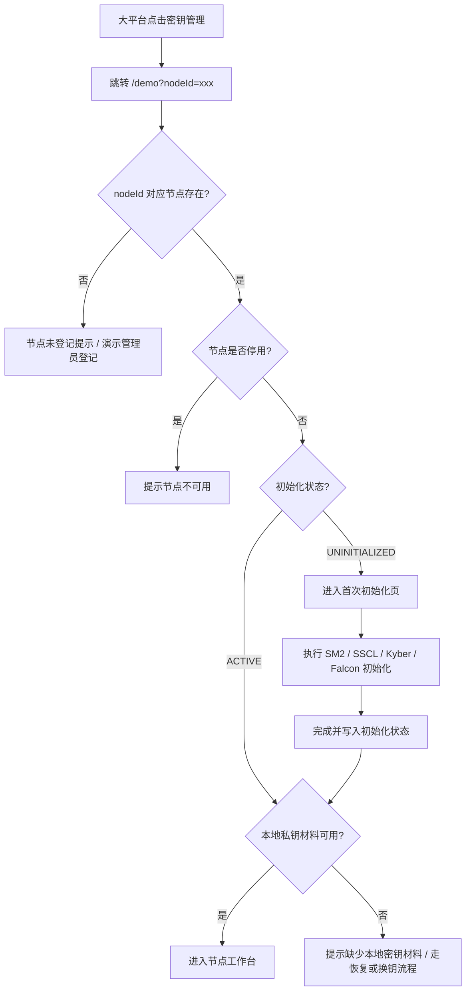

# 无证书密钥全生命周期管理系统：双路由入口与免登录演示模式改造方案

> 文档性质：**增量重构需求与实现规范**（用于交给开发人员 / Codex 落地）  
> 本次范围：**入口路由、身份上下文、管理员/节点工作台切换、节点首次初始化及激活凭证处理**  
> 核心原则：**保留原有完整流程，单独增加演示入口；业务模块共用，入口逻辑隔离。**  
> 说明：本文中的路径、字段与接口名称为**建议命名**，需根据实际项目路由和模型进行适配；本文不表示已经修改了项目源码。

---

## 1. 改造目标与边界

目前系统已经存在完整的独立运行逻辑，包括管理员账号登录、节点登录/激活、首次初始化、节点授权审批，以及密钥生成、分发、更新和回收等功能。未来系统需要嵌入大课题平台进行演示；大平台**没有统一登录页面**，只需在跳转时传入一个已存在的业务节点唯一 ID。

因此本次要求同时保留两种使用模式：

1. **原有模式（Standalone）**：所有现有认证和激活机制照常工作，便于日常开发、回归测试和独立部署。
2. **演示模式（Demo）**：在受控实验环境中免登录、免激活凭证，使用大平台传入的 `nodeId` 选择节点；首次进入完成四类基础密钥初始化，再次进入直接加载；通过页面按钮切换到独立的管理员控制台进行审批，再切回原节点。

### 必须保持不变

- 管理员与节点属于**两种不同的主体**：管理员**不是区块链业务节点**，无 `nodeId`，不生成/持有节点四套长期密钥。
- 保留四套长期密钥：**SM2、SSCL、Kyber、Falcon**；SM2/SSCL 的节点秘密份额、Kyber/Falcon 的长期私钥仍按既有设计留在节点侧。
- 保留节点权限等级（若已启用 L1/L2/L3）、节点间授权申请、管理员审批、授权撤销、审计；以原有 `UserNodeAuthorization` 等业务表/服务为唯一授权事实来源。
- 保留 Kyber 预分配、SM4 密钥分发、Falcon 签名、会话管理、密钥更新与回收的既有业务流程。
- 不要求为了演示引入大平台 SSO、管理员设备绑定、额外密码登录或全新的区块链节点体系。
- 本次**不变更**大平台提供的 Fabric/DID 区块链 SDK 接入方式；公钥上链属于独立改造任务。

---

## 2. 路由方案：两套入口，不能相互覆盖

### 2.1 建议的顶层路由

| 模式 | 顶层路由（建议） | 入口行为 | 面向对象 |
| --- | --- | --- | --- |
| 原有模式 | `/standalone/*` | 进入原有登录、激活和工作台流程 | 开发与独立测试 |
| 演示模式 | `/demo/*` | 不显示登录页，直接建立演示上下文 | 大平台集成与现场展示 |

**兼容性要求**：如果旧系统目前已使用 `/admin/login`、`/node/login`、`/admin/*` 或 `/node/*`，**不能直接删除或强制迁移旧路由**。优先让 `/standalone` 成为原有入口的统一导航页或别名；旧地址继续有效。若开发框架支持路由分组，也可将旧页面归入 `/standalone/*`，但须为旧地址设置兼容跳转并通过回归测试。

### 2.2 路由详细设计

```text
/standalone                         原有模式统一入口（按既有登录流程导航）
/standalone/admin/login             原管理员登录（或复用既有 /admin/login）
/standalone/node/login              原节点登录（或复用既有 /node/login）
/standalone/node/activate           原激活凭证流程（若原系统如此划分）
/standalone/admin/*                 原管理员工作台
/standalone/node/*                  原节点工作台

/demo                               演示入口，接收 ?nodeId=<外部已有节点唯一ID>
/demo/node                          演示节点工作台（从演示上下文获取当前 nodeId）
/demo/node/initialize               演示节点首次密钥初始化
/demo/admin                         独立演示管理员控制台
/demo/admin/authorizations          演示授权审批
/demo/admin/nodes                   演示节点管理
```

路径仅作规范示例，**最终以项目现有技术栈、路由体系为准**；不得为了引入演示模式而复制一整套业务页面。

### 2.3 大平台跳转示例

```http
GET https://<kms-host>/demo?nodeId=node-001
```

- `nodeId` 是大平台绑定的**已有业务节点唯一 ID**，不是 Fabric Peer 名称、不是一次性验证码，也不是管理员身份。
- 大平台后续再次点击系统时，仍传**同一个** `nodeId`。
- 初次跳转时不得把 `nodeId` 当作节点身份的密码学证明；在演示环境中它仅用于选择当前演示节点。
- 不向 URL 传节点私钥、SM4 明文、激活凭证或长期管理员 Token。
- `nodeId` 必须进行格式、长度和存在性校验；不得将其直接拼接到数据库语句或文件路径。

---

## 3. 原有模式：一套逻辑完整保留

### 3.1 原管理员流程

```text
/standalone
  → 原管理员登录页面
  → 原认证机制
  → 原管理员工作台
  → 创建/管理节点、审批、监管与审计
```

原管理员账户、密码校验、验证码（若原有）、会话有效性及权限拦截逻辑保持原样。

### 3.2 原节点流程

```text
/standalone
  → 原节点登录/激活页面
  → 原有凭证校验
  → 未初始化则执行原有首次初始化
  → 原节点工作台
```

- **原有模式仍生成、校验和消耗激活凭证**，不得因 Demo 改造将其全局删除。
- 原来的初始化步骤、算法实现和密钥存储方式复用已有实现。
- 开发者可独立测试整个旧认证与激活闭环，而不受演示入口影响。

### 3.3 原有模式禁止受到的影响

不得进行以下操作：

- 删除旧登录或激活接口；
- 将全局权限中间件改为直接放行所有请求；
- 把所有管理员自动视为 Demo Admin；
- 把 `activation_required` 全局改成 `false`；
- 让旧路由错误读取 Demo 身份或默认 `nodeId`；
- 因演示模式加入而改变原有用户、节点、密钥或授权记录的含义。

---

## 4. 演示模式：已有节点 ID 驱动，完全不显示登录页

### 4.1 外部节点映射

大平台需要在进入系统前选定一个已存在的**业务节点**，并向 `/demo` 传入其唯一 ID。KMS 按以下优先级解析：

1. 若外部 ID 与 KMS 业务 `node_id` 完全一致，直接查询该节点；
2. 若两套系统 ID 不同，使用 `external_node_id → kms_node_id` 映射；
3. 若查询不到已登记节点，显示“节点未登记”，可切换到演示管理员控制台登记/关联，**不得默默创建任意节点**。

建议节点关联字段：

| 字段 | 含义 |
| --- | --- |
| `external_node_id` | 大平台提供的节点唯一 ID（若与本地一致，可无需额外字段） |
| `kms_node_id` | 系统现有节点主键 |
| `node_name` | 业务节点名称 |
| `node_type` | 业务节点类型 |
| `domain_id` | 所属域（如现有系统已定义） |
| `initialization_status` | 初始化状态 |
| `permission_level` | 节点授权等级（如已实现） |

**映射必须稳定且唯一**，不因每次跳转生成新的本地节点。

### 4.2 首次进入与再次进入



#### 首次进入

- 大平台传入 `nodeId`，KMS 找到状态为 `UNINITIALIZED` 的已有节点。
- 自动进入 `/demo/node/initialize`。
- 使用现有密钥生成和初始化模块完成四套基础密钥。
- 初始化成功后，状态更新为 `ACTIVE` 并进入工作台。
- **不申请、不生成、不输入、不校验、不消耗激活凭证**。

#### 第二次及后续进入

- 大平台继续传同一个 `nodeId`。
- 读取已经存在的节点与密钥记录。
- 如果状态为 `ACTIVE` 且当前浏览器存在可用的本地密钥材料，直接进入节点工作台。
- **不重复初始化、不覆盖原有密钥、不要求提供原来的一次性凭证**。

#### 本地私钥缺失的特殊情况

服务端显示 `ACTIVE`，不代表任何浏览器都持有该节点的密钥私有材料：

- 若更换浏览器、清除存储或迁移部署导致 `NodeKeyStore` 不可用，不能自动重新生成同一密钥版本并冒充旧私钥。
- 应阻止依赖缺失私钥的签名/解封装操作，并提示“恢复原本地材料”或“按已有更新流程生成新版本”。
- `nodeId` 选择节点和“拥有该节点私钥”是两件不同的事。

### 4.3 演示管理员新增节点

在 `/demo/admin/nodes` 新增节点时：

```text
填写/关联已存在的外部业务节点 ID
  → 校验唯一性
  → 保存本地业务节点记录
  → 状态 = UNINITIALIZED
  → 等待大平台携 nodeId 进入
  → 首次初始化
```

**Demo 新增节点不生成激活凭证**，也不要求在首次进入时输入凭证。

**原有 Standalone 新增节点继续使用旧激活方式**；两种行为必须由入口上下文明确区分，不能根据用户自行传入的 `demo=true` 参数绕过原接口校验。

---

## 5. 演示管理员与节点工作台一键切换

### 5.1 角色边界

- `ADMIN`：系统级管理主体，**不是业务节点**，没有 `nodeId`，不需要四套节点私钥。
- `NODE`：拥有业务 `nodeId`，访问对应节点工作台；密钥生成、分发、签名和解封装以该节点作为业务上下文。

### 5.2 页面交互

- `/demo/node` 右上角：**「管理控制台」**，跳转 `/demo/admin`。
- `/demo/admin` 右上角：**「返回节点工作台」**，恢复进入管理员模式前选中的 `nodeId`。
- 演示管理员界面保留节点管理、L1/L2/L3 权限设置、授权申请审批、授权撤销、密钥监管和审计。
- 返回节点视角时，不能继承演示管理员的后端操作权限；视图切换同时更新服务端演示上下文。

### 5.3 授权审批演示闭环

```text
/demo/node（当前 Node A）
  → A 选择 Node B 发起密钥分发
  → 无 A→B 授权，提交申请，状态 PENDING
  → 点击「管理控制台」
/demo/admin/authorizations
  → 演示管理员审批 A→B
  → 更新原有 UserNodeAuthorization
  → 记录审批审计
  → 点击「返回节点工作台」
/demo/node（恢复 Node A）
  → 后端重新检查 A→B 授权
  → 允许继续密钥分发
```

**不得把管理员切换按钮等同于“自动批准授权”**。授权申请、审批、授权结果检查仍经过现有业务服务和数据库。

---

## 6. 后端设计：只扩展入口和认证适配，不复制业务接口

### 6.1 推荐分层

```text
HTTP / 页面路由
├── StandaloneEntry   → LegacyAuthProvider（原管理员/节点认证、激活）
└── DemoEntry         → DemoContextProvider（演示上下文，无登录/激活凭证）
                              │
                         ModeAwarePrincipal
                              │
                  统一业务应用服务 / 领域服务
                    ├─ NodeService
                    ├─ KeyGenerationService
                    ├─ KeyDistributionService
                    ├─ KeyLifecycleService
                    ├─ AuthorizationService
                    └─ AuditService
```

- 同一套密钥和授权业务接口可由两种入口调用，但进入业务层之前需解析出**可信的服务端上下文**。
- 独立模式：上下文由原认证会话解析，调用原有权限校验。
- 演示模式：**仅在明确启用的受控测试部署**内，由后端为演示会话分配受限于该测试环境的 `DEMO_ADMIN` 或 `DEMO_NODE` 上下文。
- 不允许普通请求通过传 `role=ADMIN`、`X-Role: admin` 或 `demo=true` 自行提高权限。
- 业务层仍按实际 `node_id`、节点状态、L1/L2/L3 权限及 `UserNodeAuthorization` 检查业务约束；演示管理员的审批操作仍必须经过统一授权审批服务。

### 6.2 建议入口 API（按真实代码调整）

| 接口 | 模式 | 作用 |
| --- | --- | --- |
| `GET /api/demo/entry?nodeId=...` | Demo | 解析节点、创建演示上下文、返回初始化/工作台路由 |
| `POST /api/demo/context/admin` | Demo | 在受控演示服务端会话中切换为管理员视角 |
| `POST /api/demo/context/node` | Demo | 恢复会话里保存的 `nodeId` 节点视角 |
| `GET /api/demo/context` | Demo | 查询当前演示身份、节点、初始化状态 |
| 原有认证/激活 API | Standalone | 原样保留，不允许被 Demo 参数绕过 |
| 原有密钥和授权 API | 两者共用 | 由服务端解析的模式/主体上下文进行校验 |

演示入口不应返回某个节点的完整私钥，也不应把密钥材料写入演示上下文或 URL。

### 6.3 配置开关与隔离

建议：

```env
# 仅供隔离的本地/测试环境使用
KMS_DEMO_ENABLED=true
KMS_DEMO_ALLOWED_HOSTS=127.0.0.1,localhost,kms-demo.example.internal
```

上述键名仅为建议。实际实现应：

1. Demo 模式默认**关闭**，生产/公网部署禁止自动开启；
2. 对 Demo 页面**及全部 Demo 后端接口**施加相同的网络边界或访问控制，不能仅隐藏页面入口；
3. 强烈建议使用独立测试部署和测试数据库/密钥命名空间，避免演示管理员对生产授权、密钥或用户造成影响；
4. Standalone 与 Demo 使用可区分的会话 Cookie 名称/会话空间、审计来源和本地 `NodeKeyStore` 命名空间；
5. 禁止对所有业务接口全局关闭身份认证；
6. 演示模式允许无页面登录，但**并不具备正式环境的操作者身份认证保证**，不得将它当作生产安全能力。

---

## 7. 前端实现建议

建议**共用页面组件**，仅分离外层布局和初始化入口：

```text
App
├── StandaloneShell
│   ├── ExistingAdminLogin
│   ├── ExistingNodeLoginActivation
│   ├── AdminWorkspace（共享）
│   └── NodeWorkspace（共享）
└── DemoShell
    ├── DemoEntryResolver
    ├── NodeInitialization（共享初始化组件，跳过激活检查）
    ├── AdminWorkspace（共享）
    └── NodeWorkspace（共享）
```

- 业务组件不得自行读取 URL 上的 `role` 来推断管理员身份。
- 演示路由进入时先解析 `nodeId` 和初始化状态，再渲染具体工作台。
- 切换工作台时保存并恢复当前 `nodeId`，刷新页面后从**服务端 Demo 会话**恢复；不要把管理员操作权限单纯保存在 `localStorage`。
- 同一台测试机操作多个节点时，按 `nodeId` 区分本地密钥材料，并检查当前节点私钥是否完整；不得因界面切换误用另一个节点的 Kyber/Falcon 私钥。

---

## 8. 状态管理与异常处理

| 节点/入口条件 | Demo 行为 | Standalone 行为 |
| --- | --- | --- |
| 节点未登记 | 显示关联/登记提示，不自动造节点 | 遵循现有创建/登录机制 |
| `UNINITIALIZED` | 直接首次初始化，不使用激活凭证 | 遵循原激活校验与初始化流程 |
| `INITIALIZING` | 恢复/显示进度，防止并发重复初始化 | 原流程保持兼容 |
| `ACTIVE` + 本地私钥完整 | 直接进入工作台 | 原有登录后进入工作台 |
| `ACTIVE` + 本地私钥缺失 | 提示恢复/按既有更新流程换钥 | 同样不能伪造旧私钥 |
| `DISABLED` | 禁止节点业务操作 | 保持原禁用规则 |
| 进入 `/demo/admin` | 验证 Demo 已启用且请求来自受控演示环境，切换演示管理视角 | 不影响旧管理员会话 |
| 未提供 `nodeId` | 提示缺少节点 ID，允许演示人员选择已登记的**测试**节点（如启用选择器） | 不适用 |

---

## 9. 数据库与已有功能改造范围

### 9.1 不建议改变的表和服务

- 节点主表与基础密钥记录表；
- 密钥版本、撤销、预分配资源池、Session 等核心业务表；
- `UserNodeAuthorization` 等已存在的节点间授权表；
- 既有密钥算法逻辑与区块链存证服务。

### 9.2 可能需要新增/扩展的内容

- 可选的 `external_node_id` 映射（已有统一 ID 时不新增）；
- `entry_mode` / `source_mode` 等**审计字段**（可优先通过审计事件保存，避免强制修改大量表）；
- 可识别来源的管理员审批记录：Standalone 记真实管理员；Demo 记 `DEMO_ADMIN` 且明确标记为演示操作；
- 入口适配层 DemoContextProvider，以及两套会话/密钥存储命名空间。

**原则**：不因为 Demo 模式建立第二套节点密钥表、第二套授权判据或另一套业务操作 API。

---

## 10. 验收与回归测试清单

### 10.1 Standalone 模式不可退化

- [ ] 原管理员登录和退出正常；原页面/接口地址仍可访问；
- [ ] 原节点登录与一次性激活凭证流程正常；
- [ ] 原有首次初始化和再次登录正常；
- [ ] 原管理员审批、节点授权、密钥分发及审计正常；
- [ ] 不携带任何 Demo 上下文的请求无法调用原有管理员受保护 API；
- [ ] 原有账号、激活码、会话、权限设置均未被全局绕过。

### 10.2 Demo 入口与状态恢复

- [ ] `/demo?nodeId=node-001` 能解析已登记的 `UNINITIALIZED` 节点；
- [ ] 首次初始化无需登录/激活凭证；
- [ ] 四套基础密钥初始化成功后进入节点工作台；
- [ ] 第二次相同链接直接恢复，不重新生成密钥；
- [ ] 跳转携带不存在、停用或非法的 `nodeId` 时正确报错；
- [ ] 当前浏览器缺少对应私钥时不会误判为可签名/解封装；
- [ ] `/demo/admin` 与 `/demo/node` 可切换，并准确恢复先前节点；
- [ ] Node A 与 Node B 多节点演示时，绝不混用本地私钥。

### 10.3 管理员审批闭环

- [ ] Node A → Node B 未授权时不可分发；
- [ ] Node A 提交 PENDING 申请；
- [ ] 切到管理员控制台正常审批并写审计；
- [ ] 切回 Node A 后，授权通过即可继续分发；
- [ ] 管理员撤销授权后，Node A 再次发起分发被业务服务拒绝；
- [ ] L1/L2/L3 权限（若有）仍在业务接口生效；
- [ ] Demo Admin 不是 Node A，不会持有或冒用 Node A 私钥。

### 10.4 部署隔离

- [ ] 关闭 `KMS_DEMO_ENABLED` 后，Demo 页面与 Demo API 全部不可访问；
- [ ] Demo 不会使 Standalone 鉴权中间件变成全局放行；
- [ ] Demo 不能通过任意公网 URL 无限制访问生产管理员业务接口；
- [ ] Demo 与 Standalone 的 Cookie / 演示身份上下文不会交叉串用。

---

## 11. 建议的开发实施顺序

1. **冻结并回归测试旧流程**：记录旧管理员登录、节点登录/激活、初始化和审批行为。
2. **加路由与布局**：补充 `/standalone` 和 `/demo` 两套入口，兼容现有 URL；优先只做路由，不碰业务算法。
3. **实现 Demo 节点入口**：解析外部 `nodeId`，复用节点查询，区分未初始化/已初始化/停用/私钥缺失。
4. **实现 Demo 无凭证初始化**：仅跳过演示入口的激活码验证，复用原密钥初始化服务。
5. **实现演示管理员/节点双工作台切换**：前端共用页面，后端使用隔离的演示上下文。
6. **打通节点授权演示闭环**：调用现有申请、审批、撤销和授权判定服务。
7. **隔离与测试**：限制 Demo 部署，验证两套入口互不污染、重复进入不会重复初始化。
8. **再接入大平台**：仅需要大平台跳转 `/demo?nodeId=...`；本次不要求更改大平台登录或链码。

---

## 12. 可直接交给 Codex 的实施任务定义

> 请在当前无证书密钥全生命周期管理项目中**增量增加双入口路由**，不要删除、重写或绕过现有管理员登录、节点激活、密钥初始化以及授权控制流程。为旧流程提供 `/standalone` 入口，保留原 URL 的兼容性；独立新增 `/demo` 入口，支持上级平台传入已存在节点的唯一 `nodeId`。演示入口不显示登录页、不使用一次性激活凭证：未初始化节点进入四算法初始化，已初始化节点直接进入工作台并校验本地私钥可用性；若节点未登记或被停用，应给出明确提示。演示模式支持节点工作台和独立管理员控制台一键切换，管理员不是业务节点，保留现有节点授权申请、审批、授权撤销、权限等级、审计和密钥业务流程；Demo 的审批必须通过现有授权服务。使用共享业务组件和领域服务，不能复制第二套业务逻辑。Demo 只能在受控隔离测试部署中通过配置显式启用，不能把原生产鉴权全局关闭。先检查仓库既有路由/API/表结构并给出最小改造清单，再按阶段实现和验证，记录实际修改文件、兼容性及回归测试结果。

---

## 13. 最终架构决定（简版）

- **旧系统**：`/standalone/*`，保留原有管理员登录、节点激活凭证、首次初始化及完整权限控制，用于开发测试。
- **演示系统**：`/demo/*`，传已有 `nodeId`，首次初始化、后续直达，无登录、无激活凭证；管理员界面一键切换。
- **核心业务**：只有一套节点数据、密钥服务、分发服务和授权服务；入口适配分开，服务端上下文分开。
- **安全范围**：Demo 属于受控课题展示功能，必须与正式安全入口隔离；不能把无认证管理员模式当成生产访问控制方案。
