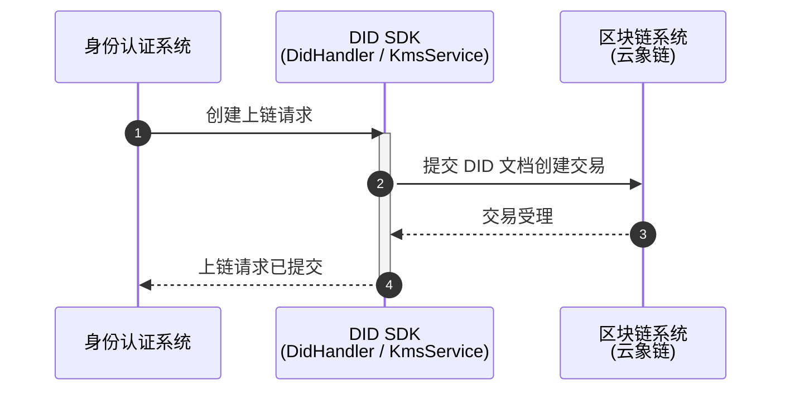
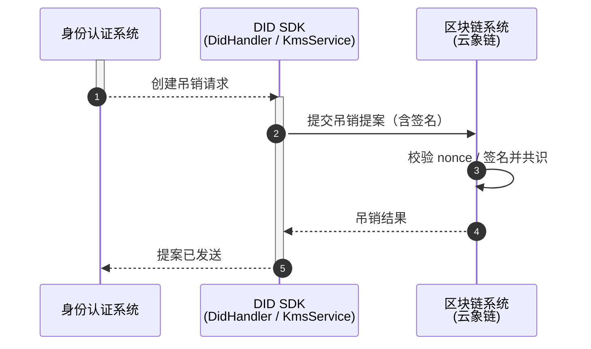
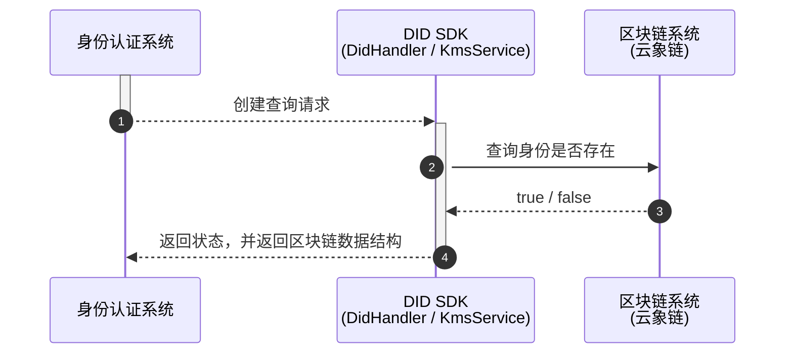

# 接口文档与时序图

> 分布式无证书认证系统 — CLA 公钥标识上链模块

## 1. 系统角色与参与方

| 参与方                  | 说明                                                              | 在本文件中的对应物                                        |
| -------------------- | --------------------------------------------------------------- | ------------------------------------------------ |
| 身份认证系统（CLA / UID 系统） | 上游调用方。持有系统公钥标识 `sysPid` 与用户公钥标识 `userPid`，负责 CLA 密钥派生与实际验签      | 调用方，非本模块代码                                       |
| 无证书分布式认证服务（本模块）      | 承接请求，生成 DID 唯一标识，编排上链 / 吊销 / 查询                                 | `ChainApi` → `ChainService` → `ChainServiceImpl` |
| DID SDK              | 生成交易 ID 与 nonce、构建 DID 文档、查询文档、生成吊销提案、发送签名提案                    | `DidHandler`                                     |
| KMS / 密钥服务           | 生成 SM2 密钥对、对提案签名                                                | `KmsService`                                     |
| 区块链系统（云象链）           | DID 文档的最终存储与共识载体，`createDidDocument` / `sendSignedProposal` 的落点 | 链网络（`NetworkHolder` 配置的通道）                       |
| CLA 密码机              | 导入 CLA 用户密钥对、SM2 验签                                             | `CLAUtils` + `CipherMachineUtils`（身份认证系统侧使用）     |

## 2. 通用约定

### 2.1 DID 唯一标识生成规则

```java
public static String getDid(String userUid) {
    Properties properties = NetworkHolder.getProperties();
    String channelName = properties.getProperty("channelName");
    if (!ReUtil.isMatch("^[a-zA-Z]+$", properties.getProperty("methodId"))) {
        throw new DidSdkException(ErrorCodeEnum.VALIDATE_ERR);
    }
    return String.format("did:%s:%s:%s", properties.getProperty("methodId"), channelName, "zhxun-test" + userUid);
}
```

- 格式：`did:{methodId}:{channelName}:zhxun-test{userUid}`
- `methodId` 必须是**纯英文字母**，否则直接抛 `DidSdkException(VALIDATE_ERR)`
- 业务名后缀 `zhxun-test` 为**硬编码**；同一 `userUid` 在 `zhxun-test` 命名空间下唯一
- `channelName` / `methodId` 来源于 `NetworkHolder` 加载的链网配置（见项目根 `config.properties` 的 `com.yunphant.yunchain.sdk.*` 开关）

## 3. 接口详情

### 3.1 标识上链

- **说明**：将系统公钥标识以 DID 文档形式写入区块链，`metadata` 直接存放 `sysPid`。

**请求参数**

| 参数     | 类型     | 必填  | 说明                    |
| ------ | ------ | --- | --------------------- |
| sysPid | String | 是   | 系统公钥标识（十六进制 ASN.1 序列） |

**实现要点**（`ChainServiceImpl#sysPidOnchain`）

1. `getDid(sysPid)` 生成 DID；
2. `kmsService.genKey().getPublicKey()` 生成并取用公钥；
3. 组装 `DocumentReq{ id, alsoKnownAs="ZHXUN_DID", publicKey, metadata=sysPid }`；
4. `didHandler.genTxId()` 获取 `txId/nonce`；
5. `didHandler.createDidDocument(documentReq, nonce)` 提交上链。

### 3.2 标识吊销

- **说明**：吊销指定标识对应的 DID 文档，使身份认证系统在验签前查询到「已失效」。

**请求参数**

| 参数      | 类型     | 必填  | 说明                        |
| ------- | ------ | --- | ------------------------- |
| userUid | String | 是   | 用户标识，用于拼装 DID（见 5.3 风险提示） |

**实现要点**（`ChainServiceImpl#deactive` → `sendSignedProposal`）

1. `getDid(userUid)` 得到待吊销 DID；
2. `didHandler.genTxId()` 获取 `txId`、`nonce`；
3. `didHandler.deactiveDid(did, did, txId)` 生成吊销提案，返回 `PropResp.payload`；
4. 私有方法 `sendSignedProposal(payload, nonce)`：
   - `genSign(payload)` → `kmsService.genKey()` 生成密钥对 → `kmsService.sign(privateKey, payload)` 得到签名；
   - 组装 `ProposalReq{ proposal, signedProp }`；
   - `didHandler.sendSignedProposal(proposalReq, nonce)` 发送带签名提案上链。

> `genSign` 每次调用都重新生成一对密钥，签名私钥**并非**该 DID 文档登记的公钥所对应的私钥，实际验签通过与否取决于链侧对提案签名方的校验策略 —— 联调时需重点确认。

### 3.3 标识查询信息及状态

- **请求参数**：`userPid`（String，必填）

**语义**：`true` 表示**有效（未吊销）**，`false` 表示已吊销**或**链上不存在该文档。

```java
Document didDocument = didHandler.getDidDocument(getDid(userPid));
if (ObjectUtil.isEmpty(didDocument)) {
    return false;                       // 文档不存在 → false
}
return !didDocument.getDeactivated();   // 取反后返回
```

## 4. 时序图

以下时序图统一以三组核心参与方刻画：**身份认证系统**（调用方）、**无证书分布式认证服务**（本模块 API + Service）、**区块链系统**（DID SDK 与云象链，KMS 作为密钥能力内聚在链交互侧展开）。

### 4.1 标识上链



### 4.2 标识吊销



### 4.3 状态查询（用户 / 系统标识）


